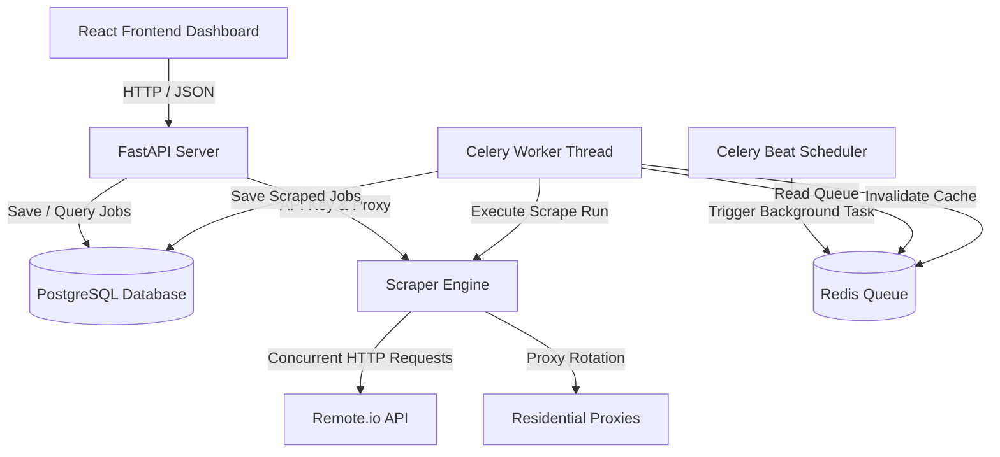

# 🌐 Remote.io Production-Grade Job Scraper & Dashboard

[](https://docs.docker.com/compose/)
[](https://www.python.org/)
[](https://fastapi.tiangolo.com/)
[](https://react.dev/)

A fully-automated, production-ready pipeline for extracting, analyzing, and exporting remote job listings from [Remote.io](https://remote.io). Built for reliability, bypassing Cloudflare blocks, and offering a gorgeous user dashboard.

---

## 🚀 Key Features

*   **⚡ Async Concurrency**: Built on `curl_cffi` to mimic real Google Chrome requests. Scrapes pages in concurrent batches, making it up to **5x to 8x faster** than normal scrapers.
*   **🛡️ Dynamic Proxy Support**: Built-in support for rotating residential proxies (configurable via the dashboard or environment files) to prevent IP bans and Cloudflare blocks.
*   **⏰ Set-and-Forget Scheduler**: Background Celery Beat scheduler executing runs automatically (e.g., hourly) with randomized delay jitter to mimic human behavior.
*   **📊 Sleek UI Dashboard**: An interactive, modern React-based frontend providing real-time telemetry, search filters, database page-by-page results, and analytics graphs.
*   **📤 Professional Reports**: Exporters producing standard Excel (`.xlsx`) and CSV formats cleanly displaying required skills, salaries, and clean URLs.
*   **🐳 Docker-first Architecture**: Containerized setup grouping PostgreSQL database, Redis message broker, Celery worker, and FastAPI server in one command.

---

## 📐 Architecture Overview

The system architecture flows as follows:



---

## ⚡ Quick Start: One-Click Installation

For users who want to run the project instantly without manual steps:

1.  **Clone or Download** the project folder.
2.  Open your terminal inside the project directory and run:
    *   **macOS / Linux / Ubuntu:**
        ```bash
        chmod +x setup.sh
        ./setup.sh
        ```
    *   **Windows:**
        Double-click `setup.bat` or run it via command prompt:
        ```cmd
        setup.bat
        ```
3.  The setup script will verify Docker, generate a `.env` file, construct database volumes, build all services, and launch the application!
4.  Once completed, open your browser and go to: **[http://localhost:8000](http://localhost:8000)**

---

## 🛠️ Configuration Settings (`.env`)

A default `.env` file will be created automatically. Adjust settings to match your production environments:

| Environment Variable | Default Value | Description |
| :--- | :--- | :--- |
| `API_KEY` | *(Set a secure string)* | Required to run scraping tasks and download reports. |
| `PROXY_URL` | *(Blank)* | A list of proxy servers (comma-separated) used to bypass IP bans. E.g. `http://user:pass@ip:port`. |
| `CORS_ORIGINS` | `http://localhost:8000,http://127.0.0.1:8000` | Whitelisted frontend addresses for API requests. |
| `POSTGRES_DB` | `remoteio_jobs` | Database name for PostgreSQL storage. |
| `REDIS_URL` | `redis://redis:6379/0` | Messaging queue connection string. |

---

## 💻 Manual Setup & Local Running

If you wish to run the pipeline services step-by-step:

### 1. Build and Launch Containers
Ensure Docker is active, then run:
```bash
docker compose up -d --build
```
This launches 5 distinct backend services:
*   `remoteio_postgres`: Database storing all job records.
*   `remoteio_redis`: Message broker and analytics cache.
*   `remoteio_api`: FastAPI server serving endpoints.
*   `remoteio_celery_worker`: Background process running scraper tasks.
*   `remoteio_celery_beat`: Cron scheduler firing automatic runs.

### 2. Access the Dashboard
Visit **[http://localhost:8000](http://localhost:8000)** in your browser.

---

## 📖 Operational Guide

### Live Scrapes from the Dashboard
1.  Enter your **API Key** in the security field at the top-right.
2.  Choose your filters: Country, Job Category, Required Skill, Workplace Type, or Salary.
3.  *(Optional)* Enter a **Proxy URL** to override default server-level configurations.
4.  Set your desired **Scrape Size Limit** (e.g., 30 jobs, 60 jobs, or all matching pages).
5.  Click **Trigger Live Scrape**. Telemetry updates dynamically, notifying you upon success.

### Exporting Scraped Data
*   Click **Export Excel (XLSX)** or **Export CSV** in the data dashboard.
*   Choose between **All Jobs** (entire database history) or **New Jobs Only** (only listings discovered in the last scrape run).

---

## 🩺 Troubleshooting & Diagnostics

### View System Status
To check if the scraper engine is active and verify system connectivity:
```bash
docker compose ps
```

### Inspect Container Logs
For active debugging, run:
```bash
# Check worker scraping logs
docker compose logs -f celery_worker

# Check HTTP API requests
docker compose logs -f api
```

### Triggering a Test Run manually
To force an instant scrape run via Docker terminal:
```bash
docker compose exec api python -c "
from app.scraper.scraper_service import run_scraper
from app.services.job_service import save_jobs
from app.database.database import SessionLocal
db = SessionLocal()
jobs = run_scraper(filters={'location': 'United States'}, max_jobs=30)
inserted, _ = save_jobs(db, jobs)
db.close()
print(f'Successfully imported {inserted} new jobs!')
"
```

---

> [!IMPORTANT]
> **API Key Safety:** Never share your API key publicly or check your completed `.env` files into source control repositories.
